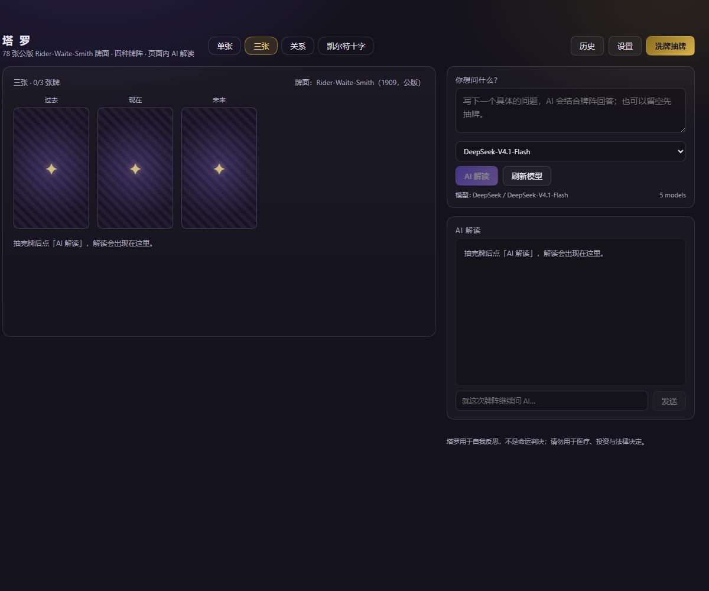
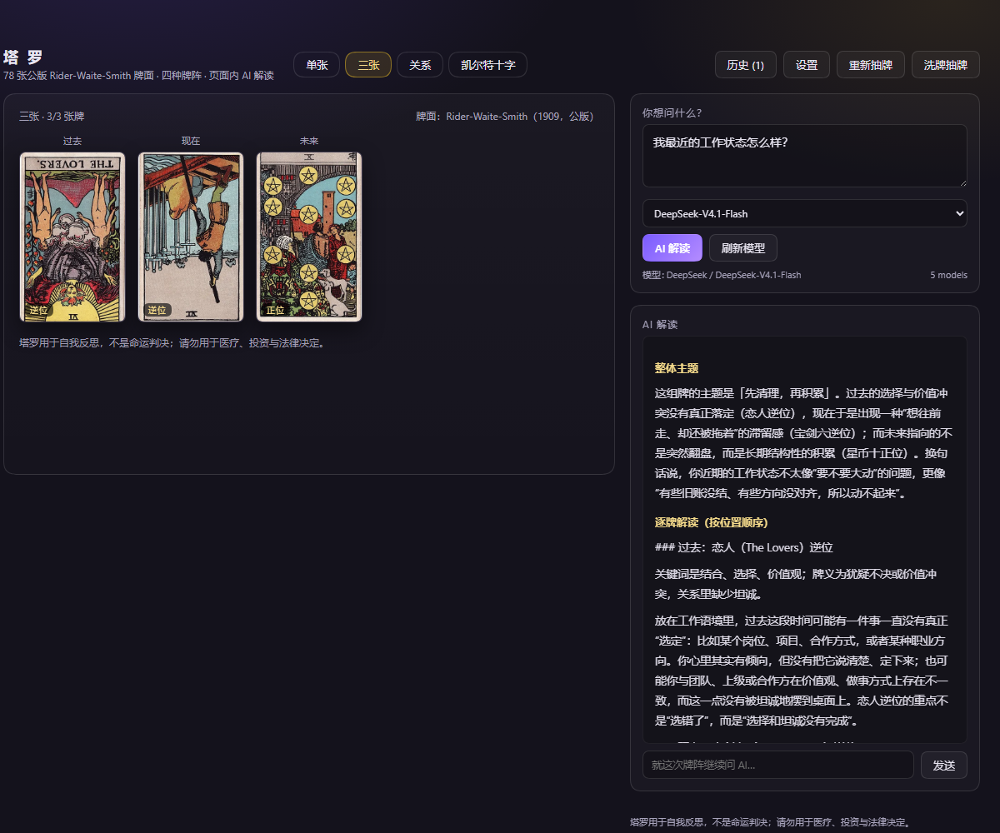
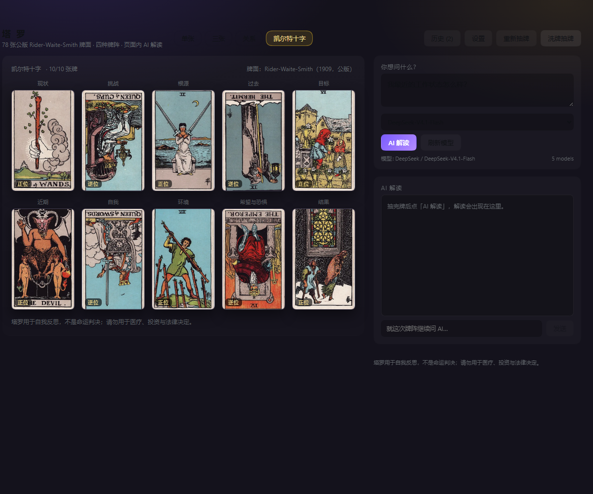

# 塔罗牌页面 · dsh-tarot-page

给 [DeepSeek Harness](https://github.com/deepseek-ai/deepseek-harness)（DSH）Web GUI 加一个**塔罗牌整页**：78 张公版 Rider-Waite-Smith 牌面、四种牌阵、洗牌/翻牌动画、历史记录，以及**页面内**的 AI 流式解读与追问。

> 这是一个社区插件，不是 DeepSeek 官方产品。AI 解读只发生在塔罗页面内部：不注册任何模型工具、skill、slash 命令或系统提示，DSH 的聊天里不会出现塔罗。



## 功能

- **78 张公版 RWS 牌面**（本地 WebP，离线可用），中英牌名、元素、大牌星象、关键词、正位/逆位牌义
- **四种牌阵**：单张 / 三张（过去·现在·未来）/ 关系 / 凯尔特十字（10 张）
- 洗牌动画、逐张翻牌、正/逆位开关、点牌看详情
- **页面内 AI 解读**：用你 DSH profile 里已配置的模型（`ctx.llm`）流式生成；可停止、可换模型、可**继续追问**（追问不会进入 DSH 会话）
- 历史记录（浏览器 `localStorage`，最多 40 条）：牌阵、问题、牌面、解读与追问，可载入/删除
- 中/英界面切换；深色页面样式，不依赖宿主主题
- 侧栏图标入口（`sidebar.panellist`）+ 主面板页面（`main` 槽位）



## 安装

```bash
# 方式一：从 npm（发布后）
plugin_manager install_bundle dsh-tarot-page

# 方式二：直接从 GitHub（无需 npm）
plugin_manager install_bundle github:camik86/dsh-tarot-page

# 方式三：CLI（写入 profile 的 dsh.profile.bundles）
dsh plugin --profile web add dsh-tarot-page
```

安装后如果提示需要重启，就重启一次 `dsh web`；随后**硬刷新**页面（Ctrl+Shift+R），侧栏会出现「塔罗」。

- 要求：DSH `>= 0.2.2-rc.1`（在该版本验证通过），Node `>= 22`
- 验证环境：Web GUI + Windows；桌面端未单独验证

## 使用

1. 侧栏点「塔罗」
2. 选牌阵 → 写问题（可选）→ 「洗牌抽牌」
3. 点任意牌看牌义；右侧点「AI 解读」→ 流式输出；下面输入框可继续追问
4. 历史/设置（正逆位、中英文、模型）在右上角

## AI 与隐私

- 模型来自你的 DSH 配置，插件**不内置任何 API key、不写遥测**；每次解读/追问是一次普通模型调用（按你的 provider 计费）
- 发送给模型的内容：问题、牌阵、每张牌的名称/位置/正逆位/牌义/关键词，以及本次解读内的追问上下文。除此之外不发送任何东西
- 牌面图片与牌义数据都在本地；历史记录只存在你的浏览器 `localStorage`
- 提示词要求模型只依据给定牌义解读，不做医疗、投资、法律、生死等确定性断言；页面底部固定显示提醒

## 牌面版权

Rider-Waite-Smith 塔罗（1909，Pamela Colman Smith 绘）已进入公有领域，来源与依据见 [ASSETS.md](ASSETS.md)。**代码** MIT，**牌面**为公版。

## 开发

```bash
npm run build        # 用 data/cards.json 重新生成 client.js（内联 78 张牌数据）
npm run fetch-cards  # 从 Wikimedia Commons 重新下载并压缩牌面（需要 Python 3 + Pillow）
npm pack             # 打 tgz，供 plugin_manager install_bundle / npm publish 使用
```

目录：

| 路径 | 作用 |
|---|---|
| `index.js` | Host 半：`/plugins/dsh-tarot-page/api/{models,interpret,chat}`（SSE）+ 牌面图片路由 |
| `src/app.js` | 页面 UI（React，无 JSX） |
| `client.js` | 构建产物（浏览器 bundle，内联牌数据） |
| `data/cards.json` | 78 张牌数据 |
| `assets/cards/*.webp` | 公版牌面 |
| `cordis.patch.yml` | 插入 `dsh-tarot-page` row |
| `locale/*.json` | 插件显示名/描述 |

## License

MIT（代码），牌面为公版（见 ASSETS.md）。

---

## English

A community plugin that adds a full **Tarot page** to the DeepSeek Harness Web GUI: 78 public-domain Rider-Waite-Smith cards, four spreads (single / three-card / relationship / Celtic cross), shuffle-and-deal animation, reading history, and an **in-page** AI reading streamed from the model configured in your DSH profile.

- Registers **no** model-facing tools, skills, slash commands or system prompts — tarot never appears in DSH chat.
- Install: `plugin_manager install_bundle dsh-tarot-page` (DSH `>= 0.2.2-rc.1`, Node `>= 22`).
- AI uses `ctx.llm` with your own credentials; the plugin ships no keys and no telemetry. Card art is public domain; code is MIT.


